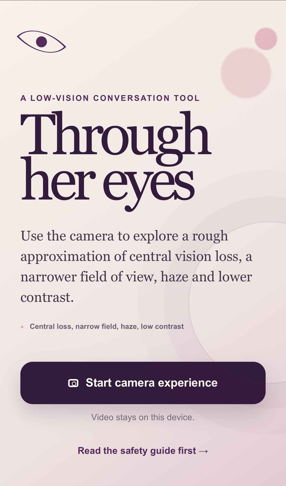
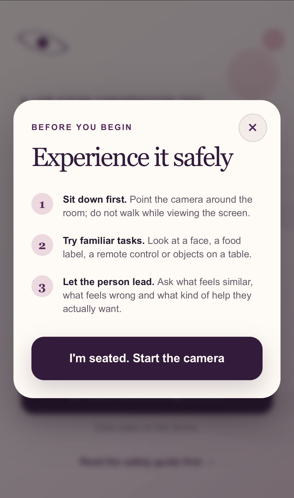

# Through Her Eyes

An open-source camera tool for talking about low vision. Families, friends, designers and developers can use it to explore visual effects and start a better conversation.

## Screenshots

<p>
  
  
</p>

This is a conversation tool, not a medical device or diagnostic tool. It cannot reproduce exactly what any person sees. A diagnosis or an acuity measurement only tells part of the story, so let the person with low vision guide the settings and the conversation.

## Features

- Live front or rear camera on supported phones and computers
- Switchable left-eye and right-eye example profiles
- Adjustable simulation strength, contrast, color, glare and haze
- Central-loss and narrowed-field overlays
- Press-and-hold comparison with the unfiltered camera view
- Safety guidance before the camera starts
- No image capture, upload, analytics or server-side processing

## Privacy

Your camera feed stays in the browser. The app does not upload or store it. The source contains no patient records, personal diagnoses, deployment identifiers, API keys or analytics code.

As with any open-source project, check your hosting provider and your changes before you deploy it publicly.

## Run locally

Requirements:

- Node.js 22 or newer
- npm

```bash
git clone https://github.com/mindthevirt/through-her-eyes.git
cd through-her-eyes
npm install
npm run dev
```

Open [http://localhost:3000](http://localhost:3000). Camera access works on `localhost`. On another device, browsers generally require HTTPS before allowing camera access.

To create and run a production build:

```bash
npm run build
npm start
```

## Run the container image

GitHub Actions builds and publishes an AMD64 image whenever changes reach `main`:

```bash
ghcr.io/mindthevirt/through-her-eyes:latest
```

After the first successful workflow run, you can start it anywhere Docker is available:

```bash
docker run --pull always -d \
  --name through-her-eyes \
  --restart unless-stopped \
  -p 3000:3000 \
  ghcr.io/mindthevirt/through-her-eyes:latest
```

Open [http://localhost:3000](http://localhost:3000). To stop the container:

```bash
docker stop through-her-eyes
docker rm through-her-eyes
```

The image is built for `linux/amd64`, which is the common server architecture. For camera access on a phone or a public site, put it behind an HTTPS-enabled domain. Browsers usually block camera access on an insecure network address.

## Using the simulator safely

- Sit or stand still while using it. Do not walk while watching the filtered feed.
- Never use it near roads, stairs, heat, sharp objects or other hazards.
- Do not treat a preset as proof of what another person sees.
- Ask the person whose vision you are discussing what feels similar, what feels wrong and what support they actually want.

## How it works

The app requests a camera stream with the browser `getUserMedia` API. CSS filters reduce detail, contrast, color and brightness. Layered gradients approximate central and peripheral field loss, glare and haze. The profile numbers are illustrative UI defaults, not clinical measurements.

## Customize

- Profile defaults: `app/page.tsx`
- Visual overlays and layout: `app/globals.css`
- Page metadata: `app/layout.tsx`

If you adapt the simulator for a specific person, keep their medical information out of the repository. Store only the minimum settings you need, obtain their consent and describe the result as an approximation.

## Contributing

Issues and pull requests are welcome. Please keep accessibility, privacy and respectful disability language central to proposed changes.

## License

[MIT](LICENSE)
